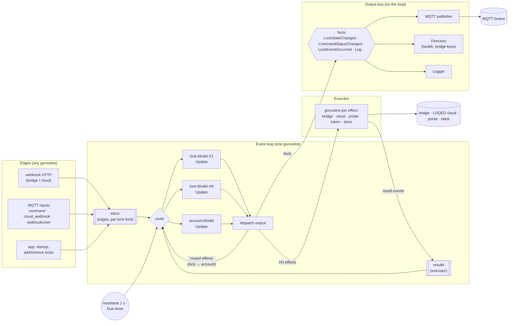
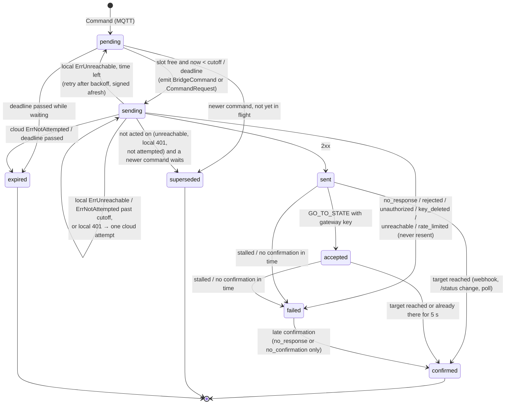
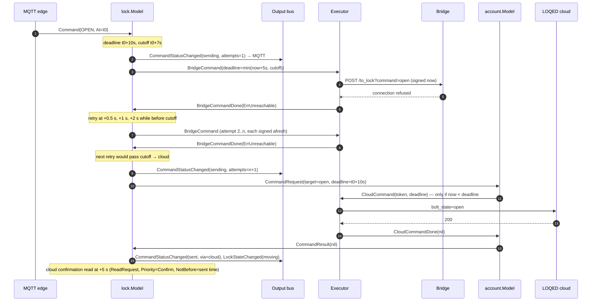
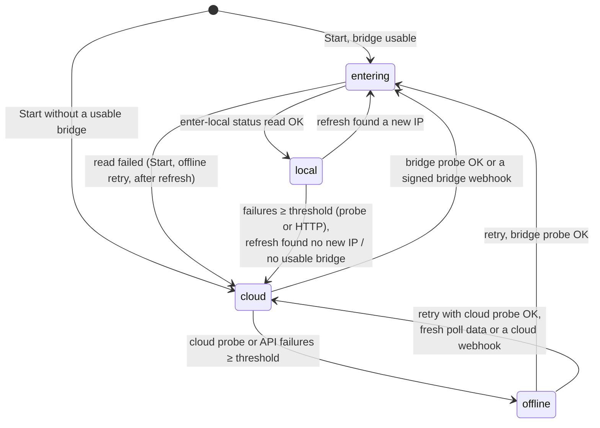
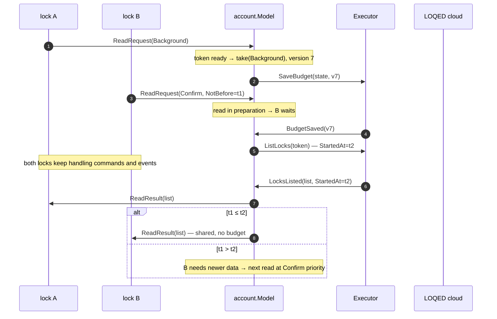

# loqed-mqtt: Elm-style engine (reducers + effects) — Design

Date: 2026-10-10 (revised 2026-10-13 after the adversarial review)
Status: Draft, for review
Findings: ARCH H1 (blocking I/O on the per-lock goroutine), ARCH H2 (`Supervisor` is a god object), COR M1 (an attempt can start after its deadline); see `.superpowers/sdd/2026-10-10-project-review/`.
Supersedes: `2026-10-10-nonblocking-supervisor-design.md` (incremental fix, not implemented).
Builds on: `2026-10-04-loqed-mqtt-gateway-design.md` (the gateway spec; "gateway 5.8" etc. refer to its sections). That spec stays the source of truth for **what** the gateway does; this one changes **how** it is structured.

## 1. Context

Today every lock runs a `Supervisor` goroutine (`internal/gateway`, ~3,200 lines) that does its own I/O synchronously: bridge HTTP calls, cloud reads through the shared `CloudHub` (semaphore, budget, token minting), credential refreshes, MQTT publishes that wait for PUBACK. Two consequences:

- **Blocking (ARCH H1, COR M1).** A slow broker, another lock's cloud read or a token mint delays a lock's commands and events. An OPEN can be sent after its 10 s deadline because nothing re-checks the deadline after the waits before the call.
- **Structure (ARCH H2).** About 60 fields on one struct, mutated from helpers that call each other re-entrantly (`commandPipeline.busy` exists only to stop re-entry through failover and `/status`). Behaviour is hard to see and hard to test without the full harness.

The chosen fix is a redesign in the style of the Elm Architecture: state changes in pure reducers, I/O described as data ("effects") and run by an executor that reports results back as events.

## 2. Goals and success criteria

1. **Nothing waits on the loop.** The event loop never performs network I/O and never waits for an MQTT acknowledgement. A lock command waits at most for its own lock's bridge call already in flight (≤ `RequestTimeout`, 5 s), as today.
2. **No attempt after its deadline (COR M1).** The reducer decides an attempt with the current time; the executor refuses to start a request whose deadline has passed and reports it as not sent.
3. **Isolation.** One lock's slow cloud read, refresh, token mint or flood of input never delays or rejects another lock's commands, events or reads.
4. **Readable state.** Each lock's state is one plain struct of named groups; every transition is a case in `Update`; tests drive `Update` with events and assert output, no goroutines or sleeps.
5. **Same behaviour.** All CLAUDE.md safety invariants hold; MQTT topics and payloads, HTTP endpoints, config, cache format and logs keep their meaning. Every existing behaviour test is ported and passes against the new engine before the swap.

## 3. Non-goals

- No change to the library module (`loqed`, `bridge`, `cloud`, `cloud/portal`) or its API.
- No change to `internal/config`, `internal/store` file format, `internal/model`, `internal/mqtt/hass`, the webhook HTTP surface or the add-on.
- No new external dependency, no framework. The plumbing is our own (~200 lines), with bubbletea-style names (`Model`, `Update`) but effects as data, not functions.
- No new features. Where the new structure forces a behaviour difference it is listed in §13 and needs the reviewer's explicit acceptance.

## 4. Architecture overview



- **Edges** turn outside input into events and put them on the inbox without blocking. A lock with too much unprocessed input gets `ErrBusy` for its own input only (§5.2).
- The **loop** stamps each event with the current time, routes it to one reducer, and dispatches the returned output in order.
- **Reducers** (`lock.Model`, `account.Model`) are deterministic: `(model, now, event) → model', output`. No I/O (not even a route lookup), no clock, no goroutines, no logger.
- Reducers return three kinds of output, in one ordered list:
    - **Routed effects** are messages between reducers (a lock asks the account for a cloud read; the account answers). The loop delivers them as events in the same dispatch round.
    - **Facts** say what happened (`LockStateChanged`, `CommandStatusChanged`, `LockEventOccurred`, `Log`, …). The loop hands each fact to the **output bus**, whose subscribers (MQTT publisher, Directory, logger) turn it into output. Reducers know nothing about MQTT, topics or logging (§5.4).
    - **I/O effects** ask for work with an answer (bridge, cloud, probes, token, store). The **executor** runs each in a goroutine and its result comes back as an event.

## 5. Core types and packages

```
loqed-mqtt/internal/engine/            loop, Event/Effect plumbing, Directory (edge snapshot, a bus subscriber), Program API, RunSync
loqed-mqtt/internal/engine/bus/        output bus: Fact dispatch to subscribers
loqed-mqtt/internal/engine/out/        output subscribers: MQTT publisher, logger
loqed-mqtt/internal/engine/lock/       per-lock reducer (one file per state group, see §6)
loqed-mqtt/internal/engine/account/    account reducer: budget, shared reads, token, cloud commands, refresh
loqed-mqtt/internal/engine/effect/     event, effect and fact types shared by reducers, bus, subscribers and executor
loqed-mqtt/internal/engine/exec/       executor: bridge/cloud/probe/token/store adapters
```

Dependency direction: `lock`, `account` → `effect`, `model`, `store` (types only), library types. `exec` → `effect`, library clients, `auth`, `store`, `webhook` (own-URL computation). `out` → `effect`, `model`, and its own `Publisher` interface (satisfied by `*mqtt.Client`; `internal/mqtt` imports nothing from the engine). `engine` → all of them. `lock` and `account` never import each other, `bus`, `out`, `exec`, `mqtt`, `webhook` or `auth`.

### 5.1 Contracts (signatures, not code)

| Name | Shape | Notes |
|---|---|---|
| `effect.Event` | marker interface | Every input to a reducer. Result events carry the `Ref` of the effect that caused them. |
| `effect.Effect` | marker interface | `Routed` (has `Target() Address`), `effect.Fact` (to the bus) or I/O (executed). |
| `effect.Fact` | marker interface (embeds `Effect`) | Something that happened; carries data only, never a topic, payload format or log handler. |
| `effect.Ref` | `struct{ Lock string; Seq uint64 }` | Unique per effect; the reducer that emitted an effect keeps its `Ref` to match the result. |
| `effect.Address` | `Account` or `Lock(id)` or `Program` | Destination of a routed effect. |
| `lock.Target` | `struct{ Record store.LockRecord; WebhookURL string; WebhookURLErr error }` | A record with `lock_settings` applied and the gateway's own webhook URL for it, computed off the loop by whoever produces the record (app at `AddLocks`, executor in `MergeLocks`). |
| `lock.Model` | struct, state groups in §6 | `New(t Target, env Env, tokenExpiry Expiry) *Model` |
| `(*lock.Model).Update` | `(now time.Time, ev effect.Event) []effect.Effect` | Mutates only its own model. |
| `(*lock.Model).Due` | `() time.Time` | Earliest scheduled time (zero: none). |
| `lock.Env` | static config + pure functions | `Timing`, `Setting`, `KeyNames`, `CloudWebhooks bool`, `ValidateBridge(rec) error` (wraps `bridge.New`: parsing only, no I/O). |
| `account.Model` | struct, §7 | `New(s account.Seed, env Env) *Model`; `Seed` = persisted budget state, cache `FetchedAt`, token expiry known at start (from `Resolver.Expiry()`, no I/O). |
| `(*account.Model).Update` / `Due` | as for `lock.Model` | |
| `engine.Program` | loop + models + bus + executor | `New(Options)`, `Run(ctx)`, `Submit(Event) error`, `AddLocks([]lock.Target)`, `Directory() *Directory` |
| `engine.RunSync` | `(ctx, m *account.Model, ev effect.Event, x Executor) ([]effect.Event, error)` | Feeds one event and runs its effects synchronously until quiescent; used by the startup refresh before the loop exists (§9) and by tests. |
| `engine.Directory` | concurrency-safe snapshot for edges; a bus subscriber | `Add(targets)`, `Remove(ids)`, `BridgeKey(id)`, `BindCloudID(id, cloudID) error`, `Health() map[string]Health`, `Known(id) bool` |
| `bus.Bus` | `Subscribe(Subscriber)` before `Run`; `Publish(effect.Fact)` (loop only) | Synchronous, in registration order. |
| `bus.Subscriber` | `Handle(f effect.Fact)` | Picks the fact types it cares about, ignores the rest. |
| `out.MQTT` | `New(p Publisher, log *slog.Logger, opts Options) *MQTT` | Subscriber: facts → MQTT topics (§5.4). |
| `out.Logger` | `New(log *slog.Logger) *Logger` | Subscriber: `Log` facts → `slog`. |
| `exec.Executor` | `Run(ctx, effect.Effect)` | One goroutine per I/O effect; results go to the loop's results channel. |

**Why mutate in place.** Go has no persistent data structures; copying a model with slices and maps on every event is error-prone. `Update` mutates the model it is called on and nothing else, so it is still a deterministic function of (model, now, event) and tests can snapshot and compare models.

**Time.** Reducers never read a clock. `now` comes from the loop per dispatch; the loop's clock is injected (`Options.Now`), so tests control it. Schedules are absolute times in the model (`nextProbe`, `confirmAt`, …).

### 5.2 The loop

```
loop:
    heartbeat := ticker every 1 s                      // fixed schedule, never pushed back by other events
    dueTimer  := re-armed after every dispatch at min(Due() over all models)
    select:
        ctx done          → return
        event from inbox  → dispatch(event)
        result            → dispatch(result)            // results for removed locks are dropped
        heartbeat         → dispatch(Tick) to every model
        dueTimer          → dispatch(Tick) to every model whose Due() ≤ now

dispatch(event):
    queue := [event]
    while queue not empty:
        ev := pop front; now := clock()
        output := target(ev).Update(now, ev)
        for each item in order:
            if routed → push back to queue as event
            if fact   → bus.Publish(fact)               // every subscriber, before the next item
            else      → executor.Run(item)              // goroutine; result comes back later
```

- **Tick is idempotent**: a model may get a heartbeat and a `Due` tick close together; `Tick` only runs schedules that are due, so a second one does nothing. The heartbeat is a fixed 1 s ticker (as today's), so a schedule a reducer forgot to report in `Due()` is late by at most 1 s however busy the loop is. `Due()` exists for sub-second schedules (local command retries after 0.5 s).
- Routed effects are processed in the same round, FIFO, so "lock asks account, account answers from its shared result" completes without a timer turn.
- **Channels.** The inbox is buffered (1,024). `Submit` also keeps a per-lock count of edge events not yet handled (in the inbox or deferred inside the model, §6.2); above 64 for one lock (today's per-lock queue) it returns `ErrBusy` for that lock only. Results: only executor goroutines send to the results channel and may block until the loop takes the result; the loop never sends to either channel, so it cannot block on them.

### 5.3 Effect catalogue

**Facts** go to the output bus (§5.4).

**Asynchronous I/O** (goroutine; result event back):

| Effect (emitted by) | Result event | Bound |
|---|---|---|
| `BridgeStatus{Ref, Record}` (lock) | `BridgeStatusDone{Ref, Status, StartedAt, Err}` | `RequestTimeout` |
| `BridgeCommand{Ref, Record, Action, Deadline}` (lock) | `BridgeCommandDone{Ref, Err}`; `Err = ErrNotAttempted` if `Deadline` had passed just before dialing | absolute `Deadline` |
| `BridgeListWebhooks{Ref, Record}` | `BridgeWebhooksDone{Ref, Hooks, Err}` | `RequestTimeout` |
| `BridgeCreateWebhook{Ref, Record, URL, Triggers}` / `BridgeDeleteWebhook{Ref, Record, ID}` | `BridgeWriteDone{Ref, Err}` | `RequestTimeout` |
| `ProbeBridge{Ref, Address}` / `ProbeCloud{Ref}` | `ProbeDone{Ref, Err}` | `RequestTimeout` |
| `ResolveToken{Ref, Op, Rejected}` (account) — `Op` ∈ get, invalidate, keyDeleted, checkExpiry | `TokenDone{Ref, Token, Expiry, Reminted, Err}` | portal timeouts |
| `ListLocks{Ref, Token}` (account) | `LocksListed{Ref, Locks, StartedAt, Err}` | `cloudTimeout` 15 s |
| `CloudCommand{Ref, Token, Lock, Target, Deadline}` (account) | `CloudCommandDone{Ref, Err}`; `ErrNotAttempted` as above | absolute `Deadline`, ≤ 15 s |
| `SaveBudget{Ref, State, Version}` (account) | `BudgetSaved{Ref, Version, Err}` | disk; one in flight at a time (§7.1) |
| `MergeLocks{Ref, Locks, TokenHash}` (account) | `LocksMerged{Ref, Targets, Removed, FetchedAt, Err}`; targets carry settings and own webhook URL | disk |

**Routed** (between reducers, no I/O):

| Effect | From → to | Meaning |
|---|---|---|
| `ReadRequest{Lock, Priority, NotBefore}` | lock → account | One cloud lock list, budgeted (§7.2). |
| `ReadResult{Lock, List, Err}` | account → lock | Shared or fresh list, or `ErrDeferred` / `ErrBudgetExhausted` / `ErrCloudBlocked` / `ErrNoCloudAccess` / API error. |
| `CommandRequest{Lock, Ref, Target, Deadline}` | lock → account | Cloud command (unbudgeted). |
| `CommandResult{Lock, Ref, Err}` | account → lock | |
| `RefreshRequest{Lock, Reason}` | lock → account | Credential refresh with per-lock backoff. |
| `RefreshResult{Lock, Reason, Target, Err}` | account → lock | `ErrRefreshThrottled` when backing off. |
| `RecordChanged{Lock, Target}` | account → lock | Only after a token remint (today's `UpdateRecords`, §7.5). |
| `TokenChanged{Expiry, Known}` | account → every lock | For `token_expires_at` in the state document. |
| `LocksRemoved{IDs}` | account → program | Stop those locks, clear their retained topics. |

### 5.4 Facts and the output bus

Reducers report what happened as facts; subscribers decide what that means for the outside world. Adding an output (metrics, a second broker, a debug feed) is a new subscriber, with no reducer change.

| Fact | Emitted when (today's call) | Subscribers |
|---|---|---|
| `LockStateChanged{Lock, State, Available}` | wherever `Supervisor.publish()` runs today, also when nothing changed (the retained topics are re-sent as today) | MQTT: retained `state` and `availability`; Directory: health |
| `LockEventOccurred{Lock, Event}` | a lock event or `command_failed` (`PublishEvent`) | MQTT: `event` |
| `CommandStatusChanged{Lock, Status}` | each command status update | MQTT: retained `command_status` |
| `WebhookListChanged{Lock, List}` | the bridge webhook list was read | MQTT: retained `webhooks` |
| `WebhooksResultReady{Lock, Result}` | a SetWebhooks request ended | MQTT: `webhooks/result` |
| `CredentialsChanged{Lock, BridgeKey}` | a lock's record changed after `Start` (`RecordChanged`, `RefreshResult`) | Directory: bridge key for webhook verification |
| `Log{Lock, Level, Msg, Attrs}` | any reducer, including its rate-limited warnings | Logger |

Rules:

- **On the loop, in order.** `bus.Publish` calls every subscriber synchronously, in registration order (MQTT, Directory, Logger), before the loop handles the next item. A lock's facts therefore reach every subscriber in the order its reducer produced them, so Home Assistant never sees `locked` before the `moving` that preceded it.
- **One-way.** Subscribers never call back into the program or a reducer and emit no effects. A subscriber that one day must tell the reducers something submits an ordinary edge event through the inbox; none does in this design.
- **Bounded.** A subscriber must return quickly. The MQTT publisher's worst case is in §8.3. Everything slower runs in the subscriber's own goroutines.
- **No secrets.** Facts carry the same data the topics carry today. `Log` attributes follow the existing no-secrets rules; the logger subscriber adds nothing.

**MQTT publisher** (`out.MQTT`):

- Maps each fact to today's `Publisher` call (`LockStateChanged` → `PublishState` then `PublishAvailability`, and so on). Topics, payloads and retain flags are unchanged.
- **Not connected → not sent** (today's guard): while paho reports the connection closed, nothing is handed to paho; retained values are still cached and go out with the reconnect republish. A QoS 1 event is never stored for replay.
- Never waits for PUBACK. For each publish it starts a goroutine that waits for the paho token (`Done()`, `PublishTimeout` 30 s, or shutdown). On an error (handoff timeout, connection lost, `ErrPublishTimeout`) it logs a rate-limited warning `publishing <kind> failed`, naming the topic kind, never the payload. An optional `OnOutcome(lock, kind, err)` hook is the place for later metrics. Outcomes never reach the reducers: no transition depends on a PUBACK.
- The outcome goroutines are not slot-bounded; each ends at PUBACK, on a paho error or after 30 s.
- Publishes the MQTT client makes on its own (discovery, the reconnect republish, removed-lock cleanup, the answer to an undelivered SetWebhooks request) stay in `internal/mqtt` and `internal/app` and keep waiting for their acknowledgement as today: they run off the loop, and removed-lock cleanup decides "cleared" from their result.

**Directory** is seeded by `AddLocks` with each lock's bridge key and persisted cloud lock id, keeps the `/healthz` snapshot from `LockStateChanged` (mode, availability, last event) and the bridge keys from `CredentialsChanged`, and forgets locks on `LocksRemoved` (`Remove`), all behind its own mutex for the HTTP goroutines.

## 6. Lock reducer (`engine/lock`)

The `Supervisor` fields become named groups. Each group lives in its own file with the functions that change it; `Update` is a switch on the event type that calls into the groups.

| Group (file) | Contents (today's fields) |
|---|---|
| `identity` (`model.go`) | id, `Target` (record with lock settings applied, own webhook URL), setting, token expiry, `recordGen` |
| `conn` (`mode.go`) | mode, the entering-local phase (§6.2), failure counters (probe, HTTP, cloud probe, cloud API), schedules (`nextProbe`, `nextCloudProbe`, `nextReconcile`, `nextCloudPoll`, `nextOfflineRetry`, `lastUnknownCheck`), `bridgeUsable` |
| `doc` (`state.go`) | published `model.State`, `lastFreshAt`, `lastEventAt`, `lastStatusStartedAt`, `lastPollAt`, `lastCloudEventAt`, `lastBoltEventAt` |
| `confirm` (`confirm.go`) | confirmation target/timers, cloud confirmation, retried/rechecked flags, `movement` |
| `delivery` (`delivery.go`) | bridge webhook delivery: `webhookConfirmed`, `lastBridgeEventAt`, `nextUnconfirmedRead`, bridge check |
| `registration` (`register.go`) | `webhookOK`, `nextWebhookRetry`, the registration job and its start time |
| `feed` (`eventfeed.go`) | published events for dedup/pairing (moved unchanged) |
| `cmds` (`pipeline.go`) | command pipeline: active, pending, watch, held-for-resolution flag |
| `hooks` (`setwebhooks.go`, `webhooklist.go`) | webhook list, revision, SetWebhooks job and queue (`planWebhooks`, `webhookRevision` moved unchanged) |
| `io` (`slots.go`) | in-flight effects: the bridge slot and its queue, the cloud read slot, the refresh slot, probe refs, deferred edge events |
| `warn` (`warn.go`) | rate-limited warnings (the 10 min repeat window) |

### 6.1 Lock events

| Event | Source | Handling (summary; details stay as in gateway 5.5–5.9) |
|---|---|---|
| `Start` | program, on add | Begin entering local if the bridge is usable (§6.2), else enter cloud. |
| `Tick` | loop | Run due schedules of the current mode (§6.4). |
| `BridgeEvent{Event}` | webhook HTTP | In local mode as `onBridgeEvent`: dedup, apply, confirm, `cmds.onReached/onGoTo`. Outside local mode: begin entering local and defer the event (§6.2). |
| `CloudEvent{Event}` | HTTP or MQTT relay | As `onCloudEvent`. |
| `Command{Command, ID, At}` | MQTT | `cmds.Submit` (§6.3). |
| `WebhooksRequest{Body}` | MQTT | SetWebhooks (gateway 5.9). |
| `RecordChanged{Target}` | account | Replace the target, bump `recordGen`, recompute `bridgeUsable`, emit `CredentialsChanged`. |
| `TokenChanged` | account | Store expiry; the next `LockStateChanged` carries it. |
| result events (§5.3) and `ReadResult`, `CommandResult`, `RefreshResult` | executor / account | Matched by `Ref` to the waiting operation (§6.2). |

### 6.2 I/O slots, operations and the entering-local phase

Today's call chains (`tryEnterLocal` → status → `registerWebhook` → list → delete → create → re-read) become **operations**: small records in the model that remember why an effect was emitted and what to do with its result.

- **Entering local.** Today `tryEnterLocal` runs synchronously, so every message waits until its `/status` read is answered: at start, on a bridge webhook outside local mode, on a successful bridge probe in cloud mode, on the offline retry, and after a refresh found a new IP. The reducer keeps that: while an enter-local `/status` read is queued or in flight, the lock **defers edge events** (commands, bridge and cloud webhooks, SetWebhooks requests) in arrival order and replays them, in that order, as soon as the read is resolved, whatever the outcome. The wait is bounded by `RequestTimeout` (5 s) plus at most one bridge call ahead of it, as today. Command deadlines keep counting from MQTT arrival. A deferred bridge webhook is therefore applied after the mode change, as today: it confirms delivery, resets the failure counters and, after `GO_TO_STATE`, schedules the confirmation read. If the read fails, the lock goes where today's caller went: `Start` and the offline retry → cloud mode (`enterCloud`), a webhook or probe in cloud mode → stays in cloud mode, after a refresh → cloud mode. The webhook registration that follows a successful enter-local runs after the replay and does not defer anything.
- **Bridge slot.** At most one bridge HTTP effect per lock is in flight (the bridge is used one call at a time today; SetWebhooks makes "one bridge call per step"). Further bridge operations wait in a short queue: an enter-local read and a **command attempt go first**, everything else in FIFO order. A queued operation has a precondition (for most: `mode == local`), checked when it is issued; an operation whose precondition no longer holds is dropped (its continuation runs its "not done" branch, e.g. a dropped confirmation read schedules the cloud confirmation if it was asked to).
- **Status read coalescing.** Reasons for `/status` (reconcile, webhook-unconfirmed read, unknown-bolt recheck, command/movement confirmation) share **one queued read**. The read keeps a set of purposes; each purpose's continuation runs on the result in today's order. A purpose that arises while a read is **in flight** never joins it (that read started before the purpose's trigger and could be a pre-command reading); it queues the next read.
- **Cloud read slot.** At most one `ReadRequest` outstanding per lock; further requests merge: a confirmation request replaces a queued background poll; of two confirmation requests the later `NotBefore` wins. The merged request is sent when the result arrives.
- **Refresh slot.** At most one `RefreshRequest` per lock; a second reason while one is outstanding is queued once.
- **Probes.** Not HTTP, so outside the bridge slot; at most one bridge probe and one cloud probe in flight.
- **Results always reach their operation.** A result is never dropped because the mode changed meanwhile; the operation's continuation evaluates today's conditions against the model as it is when the result arrives, with two guards that today's synchronous code did not need:
    - **Freshness across feeds.** Cloud lock data sets the bolt state (and clears `state_stale`) only if it was fetched at or after both `lastEventAt` (today's guard) and `lastStatusStartedAt` (start of the last applied `/status` read). Battery and online status apply as today. A background poll answered after the lock went back to local mode therefore never overwrites a newer `/status`.
    - **Record generation.** Bridge failures count toward failover only if they came from the current `recordGen` (a result from the previous IP says nothing about the new one). Their stale mark applies anyway; command results are always applied in full.

### 6.3 Command pipeline

`engine/lock/pipeline.go` keeps today's rules (gateway 5.8): latest command wins, one pending slot, deadlines (LOCK/UNLOCK 30 s, OPEN 10 s from MQTT arrival), local cutoff (10 s, OPEN 3 s, before the deadline), local backoff 0.5 s / 1 s / 2 s, one cloud attempt, retry only after `ErrUnreachable` (or no usable bridge) or `ErrUnauthorized`, never after `ErrNoResponse` or any answer. What changes is that an attempt is now two steps: **emit** and **result**.

- **In flight counts as written for superseding.** While an attempt's effect is in flight, the request may reach the lock, so a newer command waits in `pending` exactly as behind a written command. If the result proves the request was not acted on — `ErrUnreachable`, a local `ErrUnauthorized` (the bridge rejected the signature) or `ErrNotAttempted` — and a newer command is pending, the older command is superseded instead of retried or sent via the cloud, and the pending one becomes active (§13.2).
- **COR M1.** The reducer decides an attempt only with `now < cutoff` (local) or `now < deadline` (cloud), at the moment it emits the effect, after the `sending` `CommandStatusChanged` fact that precedes it in the same output list. The effect carries an absolute deadline: local `min(now + RequestTimeout, cutoff)`, cloud `deadline`. The account checks it again before it emits `CloudCommand` (a token may have had to be resolved first). The executor checks it again just before dialing, **after** it holds the per-lock bridge mutex (§8.2), and returns `ErrNotAttempted` without dialing if it has passed. `ErrNotAttempted` is provably not sent: `expired` for the cloud attempt, fall through to the cloud for a local one.
- **No cloud access.** A `CommandRequest` whose token cannot be resolved is answered `ErrNoCloudAccess` and fails the command `unreachable` (today's `ErrNoCloudAccess` path).
- **Resolution first (today's `resolved()`).** A command that resolves with `refreshAfter` or `failoverAfter` set **holds the pipeline**: the pending command is not promoted until the refresh has answered and its consequence (rebuild, enter-local, failover to cloud) is decided, so it goes out with the new record or in the new mode, as today. While held, the pending command still expires on its own deadline.
- **A result after the deadline** of a request that started in time is applied as today: a 2xx is `sent`, `ErrNoResponse` is `no_response` with confirmation, a cloud result after the local mode was left still confirms by poll.





### 6.4 Modes



`entering` is the entering-local phase of §6.2, not a published mode: the state document keeps showing the mode the lock had (`offline` before the first start, as today's initial value), and a read that fails from `cloud` returns to `cloud`. The other transitions and their side conditions stay as in gateway 5.5. The `Tick` handler per mode issues the same checks in the same order as today's `tickLocal`/`tickCloud`/`tickOffline`, but each check that needs I/O queues an operation instead of calling; the next check runs on the same tick unless the previous one changed the mode synchronously (today's early `return`s).

### 6.5 Other groups

- **Confirmation, status hint, movement** (`confirm.go`, `statushint.go`): moved unchanged in logic; they read and write only the model. A successful `/status` records `lastStatusStartedAt` for the freshness guard (§6.2).
- **Event feed** (`eventfeed.go`): moved unchanged.
- **Webhook registration** (`register.go`): an operation with steps list → delete stale (one effect each) → create → re-read; a 401 on any step issues a `RefreshRequest` and retries the job once with the new record (today's `registerWebhook`). Creating the webhook marks delivery unconfirmed only for bridge webhooks received before the job started, so evidence that arrived meanwhile is kept.
- **SetWebhooks** (`setwebhooks.go`): the job already is a step machine; its bridge calls go through the bridge slot and never start while a command is busy (unchanged rule). **Mutual exclusion with registration, both ways:** a registration job does not start while a SetWebhooks job runs (today's rule), and a SetWebhooks request is not started (stays queued) while a registration job is queued or running. A request is checked and planned only when it starts, against the list as it is then, and its first write is emitted in the same `Update`, so the plan cannot go stale in a queue. `planWebhooks` and `webhookRevision` move unchanged with their tests.
- **Warnings**: `Log` facts; the reducer keeps today's rate-limit state, so tests can assert both the line and the `repeated` count.

## 7. Account reducer (`engine/account`)

Owns everything shared by all locks: the budget, the token in use, shared read results, the cloud command path and credential refresh. It replaces `Budget`, `CloudHub`, `Refresher`, `watchTokenExpiry` and `refreshByAge`.

| Group | Contents |
|---|---|
| `budget` | `calls []time.Time`, `lastBackground`, `blockedUntil`, limit, window (today's `Budget` without its mutex), `version`, `savedVersion`, save in flight |
| `token` | token in use (or none), state `none · resolving · ready`, waiters, expiry |
| `reads` | read being prepared or in flight (ref, priority, started, the budget version of its call), waiters (lock, priority, notBefore), last result (`LockList`) |
| `commands` | cloud commands waiting for a token, in flight (ref → lock, retried-after-401 flag) |
| `refresh` | per lock+reason backoff (5 min doubling to 6 h), the refresh-all job, waiters, cache `FetchedAt` |
| `schedules` | next token expiry check (at start, then hourly), next cache-age check (hourly when `cache_max_age` > 0) |

### 7.1 Token first, then budget, persisted before the read

Gateway 5.6 takes the budget "only when a request is actually sent (not while no token is available)", and "crash loops must not exceed the budget" needs the call on disk before the request leaves. The order is therefore token → take → save → read:

```
on read due (no read in flight):
    if blocked                → answer waiters ErrCloudBlocked
    if no token ready         → emit ResolveToken(get) once; wait            // no budget taken
on token failure              → answer waiters ErrNoCloudAccess              // nothing was taken
on token ready:
    take(priority)            → ErrBudgetExhausted / ErrDeferred to waiters
    version++ ; read.needs = version ; persist()
on BudgetSaved(v):            // success or failure (failure logged once, as today)
    savedVersion = v ; save in flight = false ; persist()                    // a newer state may be waiting
    if read waiting and savedVersion ≥ read.needs → emit ListLocks(token)
on LocksListed 401:
    refund the call ; version++ ; persist() ; emit ResolveToken(invalidate, rejected)
    on new token: take(priority) again ; version++ ; read.needs = version ; persist()   // read once more
on LocksListed 429:
    block 12 h ; version++ ; persist() ; log error ; answer waiters ErrRateLimited

persist():
    if no save in flight and savedVersion < version → emit SaveBudget(state, version)
```

- **One save at a time, latest state.** At most one `SaveBudget` is in flight; changes made meanwhile are written by the next save, which always carries the newest state. Saves can therefore never land out of order (a refund overtaking a re-take).
- **Read only after its call is on disk.** `ListLocks` is emitted only once a save whose version includes that call has completed. A failed save completes too (logged once, read still sent, as today's `persistLocked`).

### 7.2 Shared reads

- A `ReadRequest` whose `NotBefore` is not after the last result's `FetchedAt`, while that result is younger than 30 s, is answered at once from it (today's coalescing).
- Otherwise, with no read being prepared or in flight, it starts one at its own priority (§7.1). Requests arriving while one is prepared or in flight wait; when it finishes, it answers every waiter whose `NotBefore` ≤ the read's `StartedAt` from the shared result, as today's second caller behind the semaphore got it, and a waiter with a later `NotBefore` starts the next read at its own priority.
- A waiter served from the shared result spends no budget and does not move `lastBackground`, as today.
- An answer is `ReadResult{List, Err}` per waiting lock; each lock applies it with today's `pollCloud` rules and the freshness guard of §6.2.



### 7.3 Token

- The account starts with the token expiry known at start (`Resolver.Expiry()`, no I/O) and hands it to every lock at `AddLocks`, so the "Token expires" sensor is set from the first state document, as today.
- `ResolveToken(get)` when a read or command needs a token and none is ready; all needs wait on the one resolution. The executor calls the existing `auth.Resolver`, which keeps its persisted mint throttle and its mutex; it is not on the loop and is the only owner of minted tokens. The account only remembers which token is in use.
- A 401 on a read or command emits `ResolveToken(invalidate, rejected)` once and retries that one request with the new token.
- A cloud command answered `cloud.ErrKeyDeleted` is never resent; `ResolveToken(keyDeleted)` replaces the token for the next request (today's `CloudHub.Command`).
- `ResolveToken(checkExpiry)` once at start and then hourly (today's `watchTokenExpiry`); a remint drops the token in use and starts a refresh-all whose records reach every lock as `RecordChanged`.
- Every change of the token in use emits `TokenChanged{Expiry}` to all locks.

### 7.4 Cloud commands

Unbudgeted and never queued behind reads: a `CommandRequest` waits only for a token if none is ready (`ErrNoCloudAccess` if none can be had). Before emitting `CloudCommand` the account checks `now < Deadline`; otherwise it answers `ErrNotAttempted`.

### 7.5 Refresh

- `RefreshRequest{Lock, Reason}`: if lock+reason is backing off → `RefreshResult(ErrRefreshThrottled)`. Otherwise mark the attempt (next = now + interval) and join the refresh-all job.
- Refresh-all is a read with `PriorityRefresh` through §7.1, then `MergeLocks` (the executor runs today's `RefreshAll` merge under `store.Update`: keep cached local credentials, empty list never applied over a non-empty cache, removed ids, new `FetchedAt`; it also applies lock settings and computes each lock's own webhook URL, which needs a route lookup).
- On `LocksMerged`, matching today's call sites:
    - every lock that asked gets `RefreshResult(target)` and its backoff updates as today (same local credentials → double, change → reset); it gets no `RecordChanged` as well;
    - only a refresh-all started by a **token remint** also sends `RecordChanged` to every other lock (today's `UpdateRecords`); a `cache_max_age` refresh updates the cache and nothing else, as today;
    - removed ids go out as `LocksRemoved` (today's `OnRemoved`).
- `cache_max_age` (hourly check against the cache `FetchedAt`) and a token remint start a refresh-all without a waiting lock.

## 8. Executor (`engine/exec`)

### 8.1 Goroutines and contexts

- One goroutine per asynchronous effect, with a context derived from the program context and the effect's deadline or timeout. No pools: in-flight effects are bounded by the slots in §6.2 and §7 (per lock: one bridge call, two probes, one read request, one refresh; account: one read, one token operation, one budget save, one merge, the cloud commands in flight).
- `ErrNotAttempted`: before dialing a command (bridge or cloud), the goroutine checks its absolute deadline, after any lock it must hold.
- Results are sent to the loop's results channel; on shutdown they are dropped.

### 8.2 Bridge clients

The executor builds a `*bridge.Client` per lock and `recordGen` on first use (pure construction, as `NewBridge` today) and keeps one per lock. As defence in depth it serializes bridge calls per lock with a mutex; the reducer's bridge slot should make it uncontended, and a test asserts that it never is. A command's deadline check runs after the mutex is held.

### 8.3 MQTT client changes (`internal/mqtt`)

The executor does no MQTT work; publishing is the `out.MQTT` subscriber's job (§5.4). The client changes it relies on:

- `SetWriteTimeout(2 * time.Second)` in the client options. paho uses it for each handoff to its writer (an unbuffered channel) and each socket write.
- `Publish*` methods keep today's not-connected guard, hand the message to paho and return its token (`Done()`, `Error()`); they no longer wait for PUBACK.
- `retainMu` covers one topic's "update cache, hand to paho"; the reconnect republish takes it per topic and sends that topic's current value, so a concurrent newer value is never overtaken by a stale one.
- The subscriber runs on the loop in fact order, so a lock's messages leave in the order its reducer produced them (paho has one writer). There is no queue of our own: paho's writer is the queue.
- **Worst case on the loop.** With a stuck socket while paho still reports connected, each publish can block up to 2 s (the handoff, or waiting for `retainMu` behind a republish handoff) until paho's failed write closes the connection; after that the not-connected guard drops publishes at once. The expected stall is a few seconds once per broken connection. This is **measured before the swap** with a test broker behind a TCP proxy that stops reading; if one stuck connection stalls the loop for more than 5 s, the swap waits for a fix (the MQTT subscriber then gets its own goroutine with a per-lock ordered hand-off).
- `Close` publishes the retained `offline` status and waits for it at most 2 s, then disconnects with a short quiesce (as today).

### 8.4 Shutdown

Cancelling the program context: the loop stops; the executor cancels in-flight effects and waits for its goroutines for at most 5 s (every effect is bounded by its own timeout anyway); results are discarded. The app then shuts the HTTP server down and closes MQTT, as today.

## 9. Edges

| Edge | Today | New |
|---|---|---|
| Bridge webhook HTTP | `Manager.BridgeKey`, `DeliverBridgeEvent` → per-lock queue | `Directory.BridgeKey` (seeded by `AddLocks`, updated by `CredentialsChanged`); `Program.Submit(BridgeEvent)`; `ErrBusy` → 503. PR #31's replay memory stays in `internal/webhook`. |
| Cloud webhook HTTP / MQTT relay | `Manager.DeliverCloudWebhook` → `BindCloudID` under the supervisor's mutex | `Directory.BindCloudID`: same rules, seeded with the persisted cloud lock id, synchronous, so HTTP still answers 409 on a mismatch. A newly learned id is saved by the Directory itself through an injected saver (`store.Update`, off the loop, as today's `SaveCloudWebhookID`). |
| MQTT command / webhooks/set | `forwardCommands` / `forwardWebhooksRequests` goroutines → `Manager` | Same goroutines → `Program.Submit`. Undelivered SetWebhooks requests are answered as today. |
| `/healthz` | `Manager.Health` reads each supervisor under a mutex | `Directory.Health` (from `LockStateChanged` facts). |
| Startup refresh | `initialRefresh` with `Refresher` | Unchanged decision rules in `internal/app` (store status, token hash, cache age, `cfg.Locks`, `ErrWrite` handling). When a refresh is needed, the app runs it synchronously before the loop starts: `engine.RunSync` feeds a startup refresh-all to the account model with the real executor. Removed ids from startup are handled by the app as today (`removedIDs`), not through `LocksRemoved`. The same account model then goes into `Program.New`. |
| Add locks | `NewManager(sups)` | The app computes each `lock.Target` (settings applied, own webhook URL with its route lookup), then `Program.AddLocks`: Directory seeded, models created, `Start` delivered. |
| Removed locks | `Refresher.OnRemoved` → goroutine → `Manager.Remove` | `LocksRemoved` → the program deletes those models (their in-flight results and deferred events are dropped), calls `Directory.Remove`, and starts the app's `OnRemoved` in a goroutine (it calls `mq.SetLocks`, which waits for publishes, so it never runs on the loop). |
| Retained inputs | ignored in `internal/mqtt` | unchanged |

## 10. Safety invariants → where they are enforced

| Invariant (CLAUDE.md) | Enforced by | Proven by |
|---|---|---|
| Retry only after `ErrUnreachable`/no bridge/`ErrUnauthorized`; never after `ErrNoResponse` or an answer | `pipeline.go` result handling; in-flight attempts count as written for superseding | ported pipeline tests; new: "newer command during an in-flight attempt waits"; harness hook: no `BridgeCommand`/`CommandRequest` after a result other than unreachable/unauthorized/not-attempted |
| Every attempt signed afresh | executor signs per `BridgeCommand` (library signs per call) | ported test (two attempts, two timestamps) |
| `DisableKeepAlives` on bridge/cloud clients | library, unchanged | library tests |
| Only webhooks confirm; `/status` is a hint | `confirm.go`, `statushint.go` moved unchanged; confirmation purposes never join an in-flight read | ported statushint and pipeline tests; new held-effect test: a `/status` started before the command is never used as its confirmation |
| Retained `command`/`cloud_webhook`/`webhooks/set` ignored | `internal/mqtt`, unchanged | unchanged tests |
| SetWebhooks: valid and revision-matched before any write; never touches the own webhook; one call per step; never during a command | `setwebhooks.go` + bridge slot + "no step while command busy" + mutual exclusion with registration + planning at start | ported setwebhooks tests; new: "a command during a step waits only for that step, and the next step waits for the command"; "a request waits while a registration job is queued or running" |
| Budget persisted; crash loops cannot exceed it; taken only when a request is actually sent | §7.1: token before take; one save at a time with the latest state; `ListLocks` only after a save containing its call | harness hooks: "no take without a token", "`ListLocks` only after a completed save whose version includes its call"; new: refund and re-take after a 401 leave the newest state on disk; ported budget tests |
| 401 reads refunded (V12) | §7.1 | ported cloudhub 401 tests |
| Bridge wire details, timestamp tolerance | library and `internal/webhook`, unchanged | unchanged tests |
| No definite state older than reality without `state_stale` | `state.go`, `confirm.go`, freshness moved unchanged; fetched-at guard across feeds (§6.2) | ported tests; new held-effect tests: a poll result arriving after a newer webhook or a newer `/status` does not overwrite it |
| A lock's MQTT messages leave in the order its reducer produced them | synchronous bus on the loop; paho's single writer | subscriber test: facts reach subscribers in order; ported pipeline tests on command status order |
| No attempt after its deadline (COR M1, gateway 5.8) | reducer check at emit + account check before `CloudCommand` + executor `ErrNotAttempted` after the bridge mutex | new tests per layer (§11) |

## 11. Behaviour (BDD skeleton)

```
engine.Program
    Run
        On an edge event
            - stamps it with the clock's now and routes it to its lock's Update
        On a routed effect
            - delivers it to the target reducer in the same dispatch round, after the items before it
        On a fact
            - hands it to every bus subscriber, in registration order, before the next item
        On an I/O effect
            - starts it on the executor without waiting
        On a result for a removed lock
            - drops it
        On the heartbeat
            - sends Tick to every model every second, however many other events arrive
        On the Due timer
            - sends Tick to every model whose Due is reached
        On context cancel
            - returns; executor goroutines are cancelled and their results discarded
    Submit
        With 64 unhandled edge events for that lock
            - returns ErrBusy for that lock only; other locks are accepted
        On an unknown lock
            - returns ErrUnknownLock
    AddLocks
        - seeds the Directory with bridge keys and persisted cloud lock ids
        - creates a model per target with the known token expiry and delivers Start
    LocksRemoved
        - deletes the models and their deferred events, calls Directory.Remove
        - starts OnRemoved in a goroutine

engine.RunSync
    - runs the effects of one event against the executor until no effect is pending
    - returns the result events, or ctx's error

engine.Directory
    BindCloudID
        On the first cloud webhook for a lock without a persisted id
            - learns the id and saves it through the injected saver
        On a lock with a persisted id
            - accepts that id without saving again
        On a different id
            - returns CloudIDMismatchError naming both ids
    BridgeKey
        - returns the key from AddLocks or the lock's latest CredentialsChanged fact
    Health
        - returns mode, availability and last event from the lock's latest LockStateChanged fact
    Remove
        - forgets the locks: Known false, no health entry, no key

bus.Bus
    Publish
        - calls every subscriber in registration order, synchronously
        - subscribers ignore fact types they do not handle

out.MQTT
    Handle
        While paho reports the connection closed
            - hands nothing to paho; retained values stay cached for the reconnect republish
        On LockStateChanged
            - publishes the retained state document, then availability
        On LockEventOccurred / CommandStatusChanged / WebhookListChanged / WebhooksResultReady
            - publishes to today's topic with today's payload and retain flag
        On any publish
            - returns without waiting for PUBACK
        On a publish error, a lost connection or no PUBACK within 30 s
            - logs a rate-limited warning naming the topic kind, never the payload
            - calls OnOutcome if set

out.Logger
    Handle
        On Log
            - writes it with slog at its level, with the lock id

lock.Model.Update
    Start
        On a usable bridge
            - begins entering local: queues the enter-local status read and defers edge events
        Without a usable bridge
            - enters cloud mode: publishes stale state, emits ReadRequest(Background)
    Entering local
        While the enter-local read is queued or in flight
            - defers commands, bridge and cloud webhooks and SetWebhooks requests in arrival order
        On the read succeeding
            - switches to local mode, applies the status, publishes state, then replays the deferred events in order, then starts webhook registration
        On the read failing after Start, the offline retry or a refresh
            - enters cloud mode, then replays the deferred events
        On the read failing after a webhook or probe in cloud mode
            - stays in cloud mode, then replays the deferred events
    Tick
        In local mode
            - queues the due checks in today's order (confirmation read, registration retry, bridge check, unconfirmed read, probe, unknown recheck, reconcile)
            - adds purposes to the queued status read; never joins a read in flight
        In cloud mode
            - emits ProbeBridge when due and ProbeCloud when due
            - emits ReadRequest(Background) when the poll is due and no read request is outstanding
            - marks the state stale when no fresh data arrived within the expected interval plus grace
        In offline mode
            - every OfflineRetry: probes the bridge, then the cloud
    BridgeStatusDone
        On success with purpose confirmation
            - applies the status as a hint and records lastStatusStartedAt; confirms the active command if the read shows the change
            - schedules one recheck after StatusRecheck while the movement is unresolved
        On failure
            - marks the state stale; counts an HTTP failure only for the current recordGen
            - with purpose confirmation via cloud: schedules the cloud confirmation
        On 401
            - emits RefreshRequest(unauthorized) unless the keys are pinned
    BridgeEvent
        Outside local mode
            - begins entering local and defers the event; it is applied after the mode change
        On a duplicate
            - publishes nothing
        On STATE_CHANGED with the target of the active command
            - confirms it and lets the pending command go
    CloudEvent
        - as onCloudEvent today; a dropped duplicate may name the published event
    Command
        In offline mode
            - fails it offline at once
        While an attempt of another command is in flight
            - keeps the new command pending; supersedes an older pending one
        On the same command as the latest
            - coalesces (new id, one status publish)
        On a free bridge slot in local mode before the cutoff
            - publishes sending, then emits BridgeCommand with deadline min(now+RequestTimeout, cutoff)
        With the bridge slot busy
            - issues the attempt first when the slot frees, re-checking the cutoff then
        While the pipeline is held for a refresh or failover
            - keeps the command pending; expires it at its deadline
    BridgeCommandDone
        On nil
            - marks sent via local, starts movement and confirmation, publishes state
        On ErrUnreachable with time before the cutoff
            - schedules a retry after the backoff (Due reports it)
        On ErrUnreachable, ErrUnauthorized or ErrNotAttempted with a newer command pending
            - supersedes this command; the pending one becomes active
        On ErrUnreachable or ErrNotAttempted past the cutoff, or ErrUnauthorized
            - publishes sending and emits CommandRequest (one cloud attempt)
        On ErrNoResponse or an answer
            - fails it (no_response / rejected), never resends, starts confirmation, marks stale if the bolt may have moved
    CommandResult
        On nil
            - marks sent via cloud and schedules the cloud confirmation
        On ErrNoResponse
            - fails no_response, never resends, schedules the cloud confirmation
        On ErrNotAttempted
            - expires the command
        On ErrNoCloudAccess
            - fails it unreachable
        On key_deleted
            - fails it and refreshes credentials once it resolved
    command resolved with refreshAfter or failoverAfter
        - holds the pipeline until the refresh answered and its consequence is applied, then promotes the pending command
    ReadResult
        On a list with this lock fetched at or after lastEventAt and lastStatusStartedAt
            - applies the bolt state; a confirmation result may confirm or fail the active command
        On a list fetched before either
            - applies battery and online only; the bolt and state_stale stay
        On ErrDeferred
            - changes nothing
        On ErrBudgetExhausted, ErrCloudBlocked, ErrNoCloudAccess or rate limited
            - marks the state stale
        On another error
            - counts a cloud API failure; offline after the threshold in cloud mode
        - sends the merged queued request, if any
    RefreshResult
        On a new target with another IP after unreachable
            - begins entering local
        On a new target after unauthorized
            - rebuilds and retries what was waiting (registration job, or nothing)
        On ErrRefreshThrottled or failure
            - falls back to cloud mode when local mode cannot continue
        - emits CredentialsChanged when the bridge key changed
    WebhooksRequest
        While a registration job is queued or running
            - queues the request
        - otherwise checks, plans and steps exactly as gateway 5.9; steps use the bridge slot and wait while a command is busy
    Due
        - returns the earliest of the model's schedules and the next local retry

account.Model.Update
    ReadRequest
        With a result younger than 30 s fetched at or after NotBefore
            - answers at once without budget
        With a read being prepared or in flight
            - adds a waiter
        Otherwise without a token
            - emits ResolveToken(get) once; takes no budget
        Otherwise with a token
            - takes the budget at the request's priority, bumps the version and persists
        When blocked after a 429
            - answers ErrCloudBlocked
        When the budget is exhausted for the priority
            - answers ErrBudgetExhausted
        On a background read within the spacing
            - answers ErrDeferred
    TokenDone for a waiting read
        On a token
            - takes the budget and persists
        On an error
            - answers the waiters ErrNoCloudAccess; no budget taken
    BudgetSaved
        - records the saved version; emits the next SaveBudget if the state changed meanwhile
        - emits ListLocks once the saved version includes the read's call, also after a failed save (logged once)
    LocksListed
        On success
            - stores the result and answers every waiter whose NotBefore ≤ StartedAt; starts the next read for the others
        On 401
            - refunds the call and persists; emits ResolveToken(invalidate); with the new token takes again, persists and reads once more
        On 429
            - blocks reads for 12 h, persists the block and answers waiters ErrRateLimited
    CommandRequest
        Before its deadline with a token
            - emits CloudCommand at once (no wait for reads)
        Without a token
            - emits ResolveToken(get) once and waits; answers ErrNoCloudAccess if none can be had
        After its deadline
            - answers ErrNotAttempted
    CloudCommandDone
        On 401
            - replaces the token and retries once
        On key deleted
            - answers the error and emits ResolveToken(keyDeleted); never resends
    RefreshRequest
        While backing off
            - answers ErrRefreshThrottled
        Otherwise
            - joins the refresh-all job
    LocksMerged
        - answers waiting locks with RefreshResult and updates their backoff
        - after a token remint only: sends RecordChanged to every other lock
        - emits LocksRemoved for removed ids
        - stores the new cache FetchedAt
    Tick
        - at start and then hourly: ResolveToken(checkExpiry)
        - hourly when cache_max_age > 0: refresh-all if the cache is older

exec.Executor
    Run
        On BridgeCommand past its deadline once the lock's bridge mutex is held
            - returns ErrNotAttempted without a network request
        On CloudCommand past its deadline
            - returns ErrNotAttempted without a network request
        On a bridge effect
            - uses the client for the record generation; never runs two calls for one lock at once
        On MergeLocks
            - merges under store.Update, applies lock settings and computes each own webhook URL
        On any async effect
            - sends exactly one result event with the effect's Ref

mqtt.Client
    client options
        - set WriteTimeout to 2 s
    Publish*
        While not connected
            - hands nothing to paho; caches retained values
        On a broker withholding PUBACK
            - returns the token without waiting
    reconnect republish
        On a value published concurrently
            - the broker's last message on that topic is the newest value
```

## 12. Testing strategy

- **Reducer tests** (`engine/lock`, `engine/account`): table tests of `(model setup, now, event) → output + model fields`. No goroutines, no fakes of I/O.
- **Scenario harness** (`engine/lock/harness_test.go`): the ported harness keeps today's verbs (`start`, `advance`, `send`, `command`, `toCloud`). It runs a lock model plus a real account model with a **synchronous fake executor** (the same `RunSync` mechanism) that resolves each effect against the existing `fakeBridge`/`fakeCloud` and feeds the result back until quiescent; `fakePub` becomes a recording bus subscriber, so assertions on published state, events and command status port unchanged. A **held** mode keeps chosen effects pending so tests can interleave: a command during a status read, a cloud poll answered after a newer `/status`, a confirmation purpose arising while a read is in flight, events during entering local, a refund save overtaken by a re-take.
- **White-box assertions.** About 117 references in today's gateway tests read `Supervisor` fields directly. They are rewritten against the new model's groups or against facts; "line for line" applies to the scenarios, not to those assertions, and the port budgets for that rewrite.
- **Invariant checks**: a harness hook validates every output list: no `BridgeCommand` after a no-response/answer result for the same command, no two bridge effects in flight per lock, no budget take without a token, no `ListLocks` before a completed save that includes its call, at most one `SaveBudget` in flight, no command effect past its deadline.
- **Program tests** (`engine`): routing, ordering of routed effects and facts, per-lock `ErrBusy`, removal dropping results and deferred events, heartbeat under a constant event stream, `Due` timer, shutdown; run with `-race -count=5`.
- **Subscriber tests** (`engine/out`): every fact maps to today's topic, payload and retain flag (compared with today's `internal/mqtt` tests); not-connected drop; outcome warnings for a withheld PUBACK (timeout), rate-limited; facts reach subscribers in order.
- **Executor tests** (`engine/exec`): `ErrNotAttempted` (including a deadline passing while waiting for the bridge mutex), the per-lock bridge mutex never contended under the reducer, one result per effect, `MergeLocks` targets.
- **MQTT stall measurement** (`internal/mqtt`): the TCP-proxy test of §8.3; its result is recorded in the swap PR.
- **App integration** (`internal/app`): the end-to-end scenarios (in-process broker, `httptest` bridge and cloud) keep their behaviour assertions; their wiring hooks move to engine equivalents (§14).

## 13. Behaviour differences (need explicit acceptance)

One change is visible from outside (13.2); the other two are a timing improvement and a rule for a situation that cannot occur today. The reviewed design otherwise keeps today's behaviour, including where that needed explicit rules: events wait while a lock is entering local mode (§6.2), a pending command waits for a refresh or failover to settle (§6.3), shared reads cost what they cost today (§7.2), and refreshed credentials reach other locks only after a token remint (§7.5).

**13.1 What a command can still wait for (improvement).** Today a command waits in the lock's queue behind whatever the supervisor is doing: a `/status` read (5 s), a cloud poll (up to ~50 s behind the hub's semaphore, a token mint and two 15 s list calls), a webhook registration chain (several 5 s calls), a credential refresh, a TCP probe (5 s) or MQTT publishes (5 s PUBACK wait each, up to 30 s on a stuck socket). New: only the one bridge HTTP call already in flight for that lock (≤ 5 s), plus an enter-local read when the lock is changing to local mode (as today); a registration chain is interrupted between steps. An OPEN's local window (7 s) can still lose up to 5 s to a status read in flight, as today. Not chosen: running commands concurrently with bridge reads, since it is unknown whether the bridge handles concurrent requests well.

**13.2 A newer command during an attempt (visible change).** Today the newer command waits in the queue until the attempt returns, and its outcome depends on that result:

| Older command's attempt | Today | New |
|---|---|---|
| 2xx, or no response | newer waits for the older's confirmation | same |
| bridge unreachable, local retries left | older superseded, newer goes | same |
| **bridge unreachable past the local cutoff, or signature rejected (401)** | **older sent via the cloud in the same step**, then the newer one | **older superseded, newer goes** |
| same command as the in-flight one | merged after the attempt | merged at once |

Example: UNLOCK, then LOCK, with the bridge down. Today the door unlocks via the cloud and locks again; new, only LOCK is sent. The older command provably never reached the lock, so dropping it is safe and matches "latest command wins"; its status ends `superseded`. The newer command's `pending` status appears at arrival instead of after the older attempt. An attempt in flight is never superseded while it may still reach the lock.

**13.3 Results from before a credential change (new situation, no visible change).** Today a refresh is synchronous, so no bridge result from the old record can arrive after the record changes. New: a `/status` to the old IP may still be in flight when a refresh delivers a new IP. Its failure does not count toward the failover threshold (it says nothing about the new IP); the stale mark still applies, and command results from the old record are always applied in full.

## 14. Migration (big-bang)

1. **Engine PRs** (new packages only, not wired): `effect` + `engine` loop + `bus` + `RunSync`; `engine/out` (MQTT publisher, logger); `engine/account` (budget, reads, token, commands, refresh) with ported `budget_test.go`, `cloudhub_test.go`, `refresher_test.go`; `engine/lock` in slices (mode + doc + slots + entering local; pipeline; confirmation + status hint + event feed; registration + delivery; SetWebhooks + list); `engine/exec`; `mqtt` client changes (§8.3: `WriteTimeout`, token-returning `Publish*` with the not-connected guard, per-topic `retainMu`; the old gateway keeps waiting on the token until the swap) and the stall measurement.
2. **Test port map** (old → new; every test name kept or mapped in the PR description):

   | Today's test file | Tests | Target |
   |---|---|---|
   | `gateway/pipeline_test.go` | 52 | `engine/lock/pipeline_test.go` (harness) |
   | `gateway/local_test.go`, `failover_test.go` | 20 + 19 | `engine/lock/mode_test.go` |
   | `gateway/delivery_test.go` | 19 | `engine/lock/delivery_test.go` |
   | `gateway/eventfeed_test.go`, `cloudevents_test.go` | 19 + 9 | `engine/lock/eventfeed_test.go`, `cloudevents_test.go` |
   | `gateway/statushint_test.go` | 12 | `engine/lock/statushint_test.go` |
   | `gateway/setwebhooks_test.go`, `setwebhooks_plan_test.go`, `webhooklist_test.go` | 21 + 4 + 11 | `engine/lock/` (plan tests unchanged) |
   | `gateway/budget_test.go`, `cloudhub_test.go`, `refresher_test.go` | 8 + 11 + 8 | `engine/account/` |
   | `gateway/manager_test.go`, `records_runtime_test.go`, `integration_test.go` | 11 + 3 + 2 | `engine/program_test.go`, `engine/directory_test.go` |
   | `app/app_test.go` (uses `gateway.Timing`, `gateway.NewManager`, `gateway.ErrBusy`) | — | same file; hooks move to `engine` options and errors |
   | `app/expiry_internal_test.go` (`watchTokenExpiry`) | — | `engine/account` expiry tests |
   | `app/webhooks_internal_test.go`, `webhook/handler_test.go` (gateway types) | — | same files against `engine.Directory` and `engine` errors |

3. **Equivalence checklist** before the swap: every ported test green; the invariant hooks enabled in every scenario test; the held-effect tests of §12 green; `internal/app` tests green against a build that wires the engine on a test-only branch; the MQTT stall measurement within 5 s; a read-only smoke run against the real bridge (status and webhook list only, no commands, no SetWebhooks writes) with zero cloud calls beyond the startup refresh; a restart in that smoke run keeps the "Token expires" sensor, the learned cloud lock id and the budget on disk.
4. **Swap PR**: `internal/app` wires `engine.Program`; `internal/webhook` uses `engine.Directory` and `engine` errors (`ErrUnknownLock`, `ErrBusy`, `ErrCloudIDMismatch`); `internal/gateway` is deleted; CLAUDE.md layout and rules (`internal/engine/lock` is the only package that knows local vs cloud; the per-lock loop invariant becomes "the event loop never does network I/O or waits for MQTT acknowledgements"), the gateway spec (§3, 5.5, 5.6, 5.8: concurrency and deadline re-check) and CHANGELOG (`Fixed`: commands are no longer delayed by a slow broker, another lock's cloud read or a token mint, and are never sent after their deadline; `Changed`: a command that never reached the lock is dropped when a newer one arrives) updated in the same PR.
5. **Release** as 0.4.0.

**Risks.** Subtle ordering drift between today's synchronous chains and queued operations (mitigated by the ported scenarios, the held-effect tests and the invariant hooks); the entering-local deferral and the held pipeline being missed in a path (each has a dedicated test); a loop stall on a stuck broker socket larger than measured (gated by the measurement); a larger test suite to maintain.

**Rollback.** Revert the swap PR: `internal/gateway` returns from history unchanged; the engine packages stay unused until fixed.

## 15. Documentation

The swap PR updates CLAUDE.md, the gateway spec and CHANGELOG as listed in §14.4. This spec gets "Status: Implemented" then. The superseded nonblocking-supervisor spec gets a "Superseded by" note.

## Appendix: adversarial review (2026-10-13)

| ID | Finding | Resolution |
|---|---|---|
| AR-1 | Refund and re-take saves could land out of order | One `SaveBudget` at a time with the latest state; read only after a save that includes its call (§7.1) |
| AR-2 | Budget taken before a token was available | Token → take → save → read (§7.1) |
| AR-3 | A late cloud result could overwrite a newer `/status` | Freshness guard across feeds (§6.2) |
| AR-4 | A confirmation could reuse a `/status` started before the command | Purposes join only a queued read (§6.2) |
| AR-5 | Heartbeat starved by a busy event stream | Fixed 1 s ticker plus a separate `Due` timer (§5.2) |
| AR-6 | Commands failed `offline` during startup | Entering-local phase defers events; failed start → cloud (§6.2, §6.4) |
| AR-7 | Webhook delivery evidence lost on a webhook-triggered enter-local | Event deferred and applied after the mode change; registration keeps newer evidence (§6.2, §6.5) |
| AR-8 | `resolved()` refresh/failover became async before the pending command | Pipeline held until resolved (§6.3) |
| AR-9 | Refreshes pushed records to every lock | `RecordChanged` only after a token remint (§7.5) |
| AR-10 | SetWebhooks could plan while registration was queued | Mutual exclusion both ways; plan at start (§6.5) |
| AR-11 | Directory not seeded with cloud lock id; subscriber emitted effects; no removal | Seeded by `AddLocks`, saves through an injected saver, `Remove` (§5.4, §9) |
| AR-12 | MQTT stall bound unproven; not-connected guard dropped | Guard kept; stall measured and gated before the swap (§8.3) |
| AR-13 | Token expiry sensor unknown until a token was resolved | Seeded from `Resolver.Expiry()`; expiry check at start (§7.3) |
| AR-14 | Account lacked startup inputs; `Await` underspecified; `OnRemoved` on the loop | Startup refresh via `RunSync` before the loop; `FetchedAt` in the seed; `OnRemoved` in a goroutine (§9) |
| AR-15 | `WebhookURL` did a route lookup inside the reducer | URL computed off the loop into `lock.Target` (§5.1) |
| AR-16 | Unspecified: token failure for commands, 401/not-attempted with a pending command, deadline check vs mutex | Specified (§6.3, §8.2, §11) |
| AR-17 | Wrong §13.2 example, incomplete diagram, line count | Shared-read difference removed (no difference); diagram and count corrected |
| AR-18 | App and webhook tests missing from the port map; white-box assertions | Added to the port map; rewrite budgeted (§12, §14) |
| AR-19 | One shared inbox let one lock's flood reject another's command | Per-lock admission limit of 64 (§5.2) |
