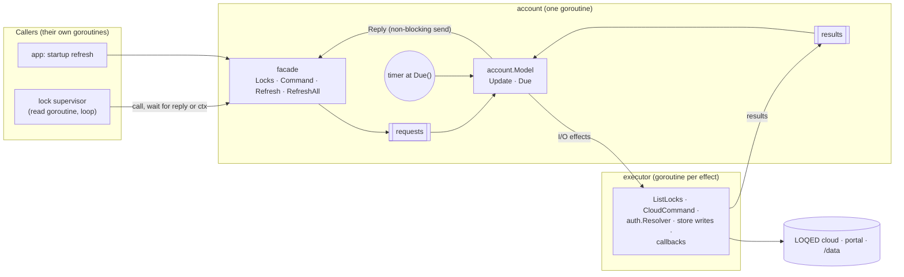

# loqed-mqtt: account reducer — Design

Date: 2026-10-17
Status: Draft, for review
Context: the "hybrid" path chosen after the Elm redesign (`2026-10-10-elm-architecture-design.md`, branch `spec/elm-architecture`) was reviewed twice. The incremental non-blocking fix (`2026-10-10-nonblocking-supervisor-design.md`, PR #33) is merged; this is the second step: the account-wide cloud state becomes one pure reducer. Lock supervisors stay goroutines and do not change.
Builds on: `2026-10-04-loqed-mqtt-gateway-design.md` (the gateway spec; "gateway 5.6" etc.).

## 1. Why

Everything the locks share about the cloud — the request budget, the shared lock list, the token in use, cloud commands, credential refresh and its backoff, the token-expiry watch and the cache-age refresh — lives today in three types and two app goroutines: `gateway.Budget` (mutex), `gateway.CloudHub` (mutex + read semaphore), `gateway.Refresher` (mutex), `app.watchTokenExpiry`, `app.refreshByAge`. Their rules interact (a remint resets the hub's token and refreshes all locks; a 401 refunds the budget and re-resolves the token; a refresh is a read at `PriorityRefresh`), but they are spread over locks, callbacks and goroutines, and are tested through timing.

Moving them into one reducer gives:

- one place, one state, for all cross-lock cloud policy; no mutex, no semaphore;
- table tests of `(state, now, event) → state', effects` for the budget, sharing, token and refresh rules;
- explicit, tested ordering of "persist the budget before the read leaves";
- the base for turning lock supervisors into reducers later, if ARCH H2 still hurts after in-place extractions.

There is no user-visible fix in this change; behaviour stays as today except where §8 says.

## 2. Goals

1. One `account.Model` reducer owns the budget, shared reads, the token in use, cloud commands, refresh (per-lock backoff and refresh-all), the token-expiry check and the cache-age refresh.
2. Lock supervisors and the `gateway.CloudSource` / `Deps.Refresh` interfaces are unchanged.
3. Same behaviour, same safety invariants (budget persisted before the read; 401 reads refunded; never resend a command after an answer; deleted keys never retried).
4. The account goroutine never blocks on I/O or on a caller.
5. Deterministic: one injected clock, no map iteration in output order, goroutine tests with `testing/synctest`.

## 3. Non-goals

- No change to lock supervisors, the command pipeline, MQTT, webhooks, the store format or the library.
- No change to `auth.Resolver`: it keeps its persisted mint throttle and its mutex, runs off the account goroutine, and stays the only owner of minted tokens.
- No output bus, no timer-helper package: the account needs neither (two schedules).
- COR M3 (a 401 followed by a failed re-mint is classified `no_response`) is not fixed here; it stays a separate finding.

## 4. Architecture



- **Package** `loqed-mqtt/internal/gateway/account`. `Priority`, `LockList` and the read errors (`ErrBudgetExhausted`, `ErrDeferred`, `ErrCloudBlocked`, `ErrRefreshThrottled`, `ErrEmptyLockList`) move there; `gateway` re-exports nothing and imports `account` where it needs them. `internal/gateway` is still the only place that knows local vs cloud.
- **Facade** `*account.Account` with `Locks`, `Command`, `Refresh`, `RefreshAll`, `Token`, `Spacing`. Each call puts a request carrying a 1-slot reply channel on the request channel and waits for the reply, its context, or the account stopping (`ErrClosed`). It implements `gateway.CloudSource` and provides `Deps.Refresh`.
- **Account goroutine** (`Run(ctx)`): selects on requests, executor results, a timer armed at `Model.Due()`, and `ctx`. For each it calls `Update(now, event)` and dispatches the effects in order: `Reply` effects are a non-blocking send on the request's 1-slot channel (a caller that gave up never blocks the account); I/O effects start a goroutine in the executor. The goroutine never sends to its own channels, so it cannot block on them.
- **Executor**: one goroutine per I/O effect, bounded by the slots below; results go to the results channel. The caller's context travels with read and command effects (as today, the caller's cancellation and deadline bound the HTTP call); background work (expiry check, merges, callbacks) uses the account's context.

## 5. Contracts (signatures, not code)

| Name | Shape | Notes |
|---|---|---|
| `account.Options` | `{Budget store.BudgetState; Limit int; Window time.Duration; CacheFetchedAt time.Time; CacheMaxAge time.Duration; Tokens TokenSource; Expiry ExpiryChecker; NewAPI func(token string) CloudAPI; Store Store; OnRemoved func(ids []string); OnReminted func(recs []store.LockRecord); Now func() time.Time; Log *slog.Logger}` | `TokenSource`, `CloudAPI` move here unchanged; `ExpiryChecker` is `CheckExpiry(ctx) (bool, error)` (`auth.Resolver`); `Store` is the part of `*store.Store` the merge and budget save need. |
| `account.New(o Options) *Account` | | Builds the model and the executor; nothing runs until `Run`. |
| `(*Account).Run(ctx)` | blocks until `ctx` ends | |
| `(*Account).Locks(ctx, p Priority, notBefore time.Time) (LockList, error)` | as `CloudHub.Locks` | |
| `(*Account).Command(ctx, lockID string, s loqed.BoltState) error` | as `CloudHub.Command` | |
| `(*Account).Refresh(ctx, lockID string, reason Reason) (store.LockRecord, error)` | as `Refresher.Refresh` | |
| `(*Account).RefreshAll(ctx) ([]store.LockRecord, error)` | as `Refresher.RefreshAll` | |
| `(*Account).Token() string`, `Spacing() time.Duration` | read-only | `Token` answers from a snapshot the goroutine updates; `Spacing` is static. |
| `account.Model` | struct, §6 | `Update(now time.Time, ev Event) []Effect`, `Due() time.Time`; mutates only itself. |
| `account.Budget` | value type: `Take(p, now) error`, `Refund()`, `Block(now, d)`, `State() store.BudgetState`, `Spacing()` | Today's `Budget` without its mutex and save callback. |

## 6. The model

| Group | Contents |
|---|---|
| `budget` | `Budget` value; `version` (bumped on every change), `savedVersion`, save in flight |
| `token` | token in use, state `none · resolving · ready`, who waits for it |
| `reads` | FIFO queue of read requests (priority, notBefore, reply, caller ctx); the head being served (phase `token · saving · listing · reauth`, budget version of its call, retried flag, started); last shared result |
| `commands` | commands waiting for a token; commands in flight (retried-after-401 flag) |
| `refresh` | backoff per lock+reason (next, interval: 5 min doubling to 6 h); the refresh-all job (waiters, origin: request · startup · remint · age) |
| `cache` | `FetchedAt` (from `Options`, updated by every merge) |
| `schedules` | next expiry check (at start, then hourly), next cache-age check (hourly when `cache_max_age` > 0) |

### 6.1 Reads: today's semaphore, without blocking

Today callers take turns at `CloudHub.reads`; each checks the shared result, then takes the budget at **its own** priority and calls. The model keeps exactly that order:

```
serve():   // after every event that can unblock the head
    while a request is queued and none is being served:
        w := head
        if last result has Locks, is < 30 s old and FetchedAt ≥ w.notBefore → Reply(w, last); pop; continue
        if w.ctx is done → Reply(w, ctx error); pop; continue
        if token not ready → ResolveToken(get) once; head waits (phase token); return
        if err := budget.Take(w.p, now) → Reply(w, err); pop; continue      // only w gets its refusal
        version++ ; head.needs = version ; persist() ; phase saving ; return

on BudgetSaved(v):                       // success, or failure logged once (as today), read still sent
    savedVersion = v ; persist()         // a newer state may be waiting
    if head in phase saving and savedVersion ≥ head.needs → ListLocks(token, w.ctx) ; head.started = now ; phase listing

on LocksListed(locks, err):
    401 and not retried → Refund ; version++ ; persist() ; ResolveToken(invalidate, token) ; phase reauth
        TokenDone ok   → retried ; Take(w.p, now): err → Reply(w, err) ; else version++, needs = version, persist(), phase saving
        TokenDone err  → Reply(w, join(401, err))
    401 after retry → Refund ; persist() ; Reply(w, err)
    429             → Block(now, 12 h) ; version++ ; persist() ; log error ; Reply(w, err)
    other error     → Reply(w, err)
    ok              → last = {locks, FetchedAt: head.started} ; Reply(w, last)
    pop ; serve()

persist():
    if no save in flight and savedVersion < version → SaveBudget(budget.State(), version)
```

- **One save at a time, latest state.** Saves cannot land out of order (a refund overtaking a re-take); a read leaves only after a save containing its call completed.
- **Each request at its own priority**, so a confirmation read never inherits a background poll's refusal.
- **Token failures** are replied as errors, as today, so supervisors still count them toward offline.
- The head is served with its caller's context; when that caller gives up, its read ends with the context error and the next request is served, as today.

### 6.2 Cloud commands

Commands never queue behind reads. With a ready token: `CloudCommand(token, lock, target, ctx)` at once. Without: `ResolveToken(get)` once, the command waits for it; a token failure is replied as `ErrNoCloudAccess`-wrapped, as today. On `CloudCommandDone`: 401 → `ResolveToken(invalidate)` once and resend once (a rejected request did nothing); `cloud.ErrKeyDeleted` → reply the error, never resend, `ResolveToken(keyDeleted, token)` replaces the token for the next request; otherwise reply. Log lines as today ("sending cloud command", key deleted).

### 6.3 Refresh

- `Refresh(lockID, reason)`: while lock+reason backs off → `ErrRefreshThrottled`. Otherwise next = now + interval, and the request joins the refresh-all job (starting one if none runs).
- A **refresh-all job** is one read at `PriorityRefresh` through §6.1, then `MergeLocks` (the executor runs today's `RefreshAll` merge under `store.Update`: keep cached local credentials, never apply an empty list over a non-empty cache (`ErrEmptyLockList`), drop locks no longer listed, write `FetchedAt` and the token hash; a `store.ErrWrite` still returns the fresh records). The executor returns the records, the removed ids, the new `FetchedAt`, the records before the merge and the error.
- On `LocksMerged`: each waiting `Refresh` gets its lock's record, or "no longer on the account"; its backoff updates as today (same local credentials → double, change → reset; failure → double); `RefreshAll` callers get the records; removed ids → `OnRemoved` (called by the executor in its own goroutine, as today's callback ran on a supervisor goroutine and was moved off it by the app).
- Requests that arrive after a job's read has been answered start the next job.

### 6.4 Token in use, expiry and cache age

- The token in use is resolved lazily (first read or command), invalidated after a 401, replaced after a deleted key, as `CloudHub` does today. `Token()` answers from a snapshot.
- **Expiry check** (today's `watchTokenExpiry`): due at `Run` start and then hourly; `CheckExpiry` effect. On `Reminted`: the token in use is dropped (today's `hub.ResetToken`), and a refresh-all job with origin remint starts; its records go to `OnReminted` (the app passes `manager.UpdateRecords`). An error is logged at debug, as today.
- **Cache age** (today's `refreshByAge`): hourly when `cache_max_age` > 0; if `now − FetchedAt ≥ cache_max_age`, a refresh-all job with origin age starts; a failure is logged as today.

### 6.5 In-flight bounds

At most: one read, one token resolution, one budget save, one merge, one expiry check, plus the cloud commands in flight (each bounded by its caller's deadline). Requests wait in the model, not in goroutines.

## 7. App wiring

- `account.New` replaces `NewBudget`, `NewCloudHub`, `NewRefresher`; `acct.Run(ctx)` starts before `initialRefresh`, which calls `acct.RefreshAll` (its decision rules are unchanged; it still asks `resolver.Token` directly to compare the token hash).
- `Deps.Cloud = acct`, `Deps.Refresh = acct.Refresh`, `DefaultTiming(…, acct.Spacing())`.
- `refresher.OnRemoved` becomes `Options.OnRemoved` (same body); the remint callback becomes `Options.OnReminted`.
- `watchTokenExpiry` and `refreshByAge` are deleted.
- `TokenExpiry: resolver.Expiry` for the state document stays as is.

## 8. Behaviour differences

1. **Concurrent refreshes merge once.** Today two locks refreshing at the same time each call `RefreshAll`; the second usually gets the 30 s shared list (no extra cloud call) and merges again. Now they join one job: same cloud calls, one merge, one `OnRemoved`.
2. **A waiting caller that gives up no longer holds a place.** Today a caller blocked on the semaphore releases it when its context ends; here its queued request is answered with the context error when it reaches the head (no network call). Same cloud calls.

No other observable change; the read, budget, token and command rules are today's.

## 9. Behaviour (BDD)

```
account.Model.Update
    ReadRequest
        With a result younger than 30 s, fetched at or after NotBefore
            - replies it at once; takes no budget
        While another read is being served
            - queues the request in arrival order
        At the head without a ready token
            - emits ResolveToken(get) once; takes no budget
        At the head with a token
            - takes the budget at this request's own priority, bumps the version and emits SaveBudget
        When the budget refuses this request (exhausted, deferred, blocked)
            - replies that error to this request only and serves the next one
        At the head with its context done
            - replies the context error without a call
    BudgetSaved
        - records the saved version; emits SaveBudget again if the state changed meanwhile
        - emits ListLocks once a saved version includes the head's call, also after a failed save (logged once)
    LocksListed
        On success
            - stores the shared result with FetchedAt = the time ListLocks was emitted, replies it and serves the next request
        On 401, first time
            - refunds the call, persists, emits ResolveToken(invalidate)
        On TokenDone after a 401
            - takes the budget again, persists and lists once more; a refusal or token error is replied
        On 401 after the retry
            - refunds, persists and replies the error
        On 429
            - blocks reads for 12 h, persists, logs an error and replies the error
        On another error
            - replies it and serves the next request
    SaveBudget ordering
        - never more than one in flight; each carries the newest state
    CommandRequest
        With a ready token
            - emits CloudCommand at once, never behind reads
        Without a token
            - emits ResolveToken(get) once and waits; a token error is replied as no cloud access
    CloudCommandDone
        On 401
            - replaces the token and resends once
        On a deleted key
            - replies the error, never resends, emits ResolveToken(keyDeleted)
        Otherwise
            - replies the result
    RefreshRequest
        While lock+reason backs off
            - replies ErrRefreshThrottled
        Otherwise
            - sets the next attempt and joins the refresh-all job (starting one if none runs)
    LocksMerged
        - replies each waiting Refresh with its record or "no longer on the account" and updates its backoff as today
        - replies RefreshAll callers
        - emits OnRemoved for removed ids
        - stores the new cache FetchedAt
        After a remint
            - emits OnReminted with the records
    Tick
        At start and then hourly
            - emits CheckExpiry
        Hourly with cache_max_age > 0 and the cache older
            - starts a refresh-all job
    ExpiryChecked
        On reminted
            - drops the token in use and starts a refresh-all job with origin remint
    Due
        - returns the earlier of the next expiry and cache-age check

account.Account
    Locks / Command / Refresh / RefreshAll
        - send a request and return its reply
        On the caller's context ending first
            - return the context error; the account goroutine is not blocked
        After Run returned
            - return ErrClosed
    Run
        - handles requests, results and the Due timer until ctx ends
        - never blocks on a caller or on I/O
```

## 10. Testing

- **Reducer tables** (`account/model_test.go`): one test per effect above, with an explicit `now`.
- **Ported tests:** `gateway/budget_test.go` (8) → `account/budget_test.go`; `gateway/cloudhub_test.go` (11) and `gateway/refresher_test.go` (8) → `account/` through the facade with a fake `CloudAPI`, `TokenSource` and store; `app/expiry_internal_test.go` → `account/expiry_test.go`; the cross-lock test in `gateway/cloudread_test.go` uses `account.New` instead of `NewCloudHub`.
- **Goroutine tests** with `testing/synctest`: a caller that gives up doesn't block the account; `Run` returns on cancel with executor goroutines finished; facade after `Run` returns `ErrClosed`; a blocked `ListLocks` doesn't delay a cloud command.
- **Invariant checks** in the reducer tests: no `ListLocks` before a completed save that includes its call; at most one `SaveBudget` in flight; no take without a token.
- `internal/app` end-to-end tests unchanged; `go test -race -count=5 ./internal/gateway/... ./internal/app`.

## 11. Delivery

One PR from master (`refactor/account-reducer`), one commit per step, each green:

1. `account` package: `Budget` value type, model, facade, executor; reducer and goroutine tests.
2. Port the budget, cloudhub, refresher and expiry tests to it.
3. App wiring switches to `account`; the cross-lock gateway test moves to it.
4. Delete `gateway.Budget`, `CloudHub`, `Refresher`, `app.watchTokenExpiry`, `app.refreshByAge`.
5. Docs: CLAUDE.md layout line (`internal/gateway/account`), gateway spec 5.2/5.6 (where the rules live). No CHANGELOG entry: no user-visible change.

Rollback: revert the PR.
